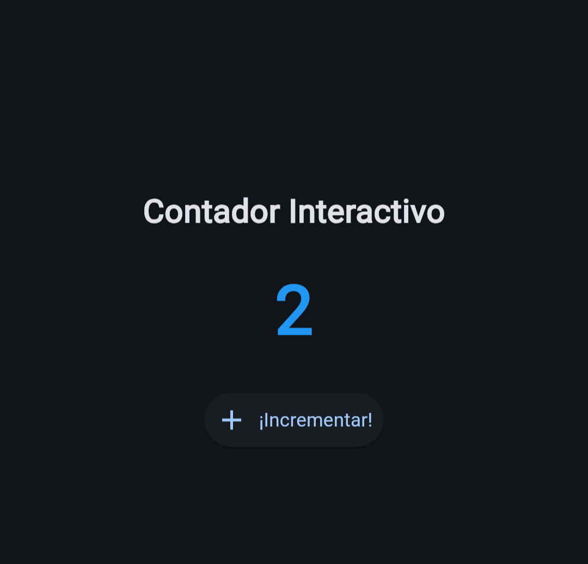

# Taller de Investigación: Explorando Flet para Interfaces Gráficas con POO en Python

**Asignatura:** Programación Orientada a Objetos  
**Tema:** Interfaces Gráficas de Usuario (GUI) y Programación Orientada a Eventos  

---

## 📋 1. Selección de la Biblioteca

* **Biblioteca:** [Flet](https://flet.dev/)
* **Propósito Principal:** Permitir a los desarrolladores de Python construir aplicaciones de interfaz gráfica (GUI) interactivas, modernas y multiplataforma de forma sencilla, sin necesidad de dominar tecnologías complejas de frontend como JavaScript, HTML o CSS. Flet utiliza el motor de **Flutter** por debajo para renderizar los componentes visuales de manera nativa y fluida.

---

## 🔬 2. Investigación

### ¿Qué tipo de aplicaciones permite desarrollar?
Flet permite crear aplicaciones de escritorio (Windows, macOS, Linux), aplicaciones web (convertibles en PWA) y aplicaciones móviles (Android e iOS) utilizando exactamente la misma base de código escrita en Python.

### ¿Cómo se instala y qué requisitos necesita?
* **Requisitos:** Tener instalado Python 3.8 o superior y el gestor de paquetes `pip`.
* **Instalación:** Se instala directamente desde la terminal ejecutando:
  ```bash
  pip install flet
  ```

### ¿Cuáles son sus principales componentes o elementos gráficos?
Flet organiza la interfaz mediante una jerarquía de *controles* (equivalentes a los widgets de Flutter):
* `ft.Page`: La ventana o lienzo principal de la aplicación.
* `ft.Text`: Control para mostrar texto estático o dinámico.
* `ft.ElevatedButton` / `ft.IconButton`: Botones interactivos con estilos modernos.
* `ft.TextField`: Campo para entrada de texto por parte del usuario.
* `ft.Row` y `ft.Column`: Contenedores flexbox para organizar elementos horizontal o verticalmente.

### ¿Cómo maneja los eventos del usuario?
Flet utiliza un enfoque de programación orientada a eventos vinculando propiedades como `on_click`, `on_change` o `on_submit` a funciones o métodos *callback*. Cuando el usuario realiza una acción (como hacer clic en un botón), Flet detecta la interacción y ejecuta automáticamente la función asociada, pasando un objeto de evento (`ControlEvent`) con información del contexto.

### ¿Qué ventajas y limitaciones presenta frente a Tkinter?
| Criterio | Flet | Tkinter |
| :--- | :--- | :--- |
| **Diseño** | Moderno por defecto (Material Design 3). | Apariencia clásica/antigua de SO. |
| **Multiplataforma** | Escritorio, Web y Móvil (Android/iOS). | Principalmente Escritorio. |
| **Curva de Aprendizaje** | Reactiva y orientada a objetos moderna. | Imperativa y basada en coordenadas/grid. |
| **Consumo de Recursos** | Mayor consumo (requiere motor Flutter/WebSockets). | Ultraligero y nativo de Python. |

### Fuentes Consultadas
1. Flet Developer Documentation: [https://flet.dev/docs/](https://flet.dev/docs/)
2. Flet GitHub Repository: [https://github.com/flet-dev/flet](https://github.com/flet-dev/flet)
3. Python Package Index (PyPI) - Flet: [https://pypi.org/project/flet/](https://pypi.org/project/flet/)

---

## 🛠️ 3. Explicación del Ejemplo Mínimo y Orientación a Objetos

### Explicación del Funcionamiento
1. **Creación de la Ventana Principal:** Se obtiene una instancia de `ft.Page` en la función principal. Se configuran las propiedades visuales de la ventana (título, dimensiones y alineaciones).
2. **Creación de Componentes Gráficos:** Los elementos `ft.Text` y `ft.ElevatedButton` se instancian dentro de la clase `ContadorApp` y se organizan verticalmente usando `ft.Column`.
3. **Detección del Evento:** El botón `ft.ElevatedButton` define la propiedad `on_click=self.incrementar_contador`. Al hacer clic sobre él, la aplicación intercepta el evento.
4. **Respuesta al Evento:** El método `incrementar_contador(self, e)` modifica la variable de estado `self.contador`, actualiza el texto con `self.lbl_contador.value = str(self.contador)` y refresca la vista con `.update()`.

### Reto Adicional: Estructura Orientada a Objetos (POO)
La aplicación fue desarrollada encapsulando toda la lógica e interfaz dentro de la clase `ContadorApp`:
* **Atributos de Estado:** `self.contador` almacena el valor numérico actual.
* **Atributos Visuales:** `self.lbl_contador` y `self.btn_incrementar` mantienen referencias directas a los controles de la interfaz.
* **Métodos de Evento:** `incrementar_contador()` actúa como el manejador (*handler*) encendido por la interacción del usuario.

---

## 🚀 4. Instrucciones de Instalación y Ejecución

1. **Clonar el repositorio:**
   ```bash
   git clone https://github.com/TU_USUARIO/NOMBRE_DE_TU_REPOSITY.git
   cd NOMBRE_DE_TU_REPOSITY
   ```

2. **Instalar dependencias:**
   ```bash
   pip install -r requirements.txt
   ```

3. **Ejecutar la aplicación:**
   ```bash
   python main.py
   ```

---

## 📸 5. Evidencia de Funcionamiento

*(Agrega aquí una captura de pantalla de la aplicación ejecutándose)*

